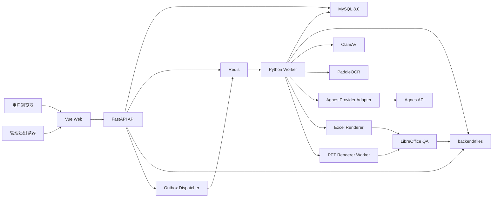

# Office AI 双输出 Alpha Implementation Plan

> **For Codex:** 按本文档顺序在当前任务中实施。除非用户明确要求，不使用 subagent 或并行代理。每完成一个任务，更新进度文档并执行对应验证。

**Goal:** 在 4 周内交付一个可在 Windows 本地运行、可使用真实 Agnes API、能够从销售材料同时生成合格 PPTX 与 XLSX 的内部 Alpha。

**Architecture:** Vue 负责用户端与管理端界面，FastAPI 负责鉴权、资产、项目、任务和管理 API，MySQL 8.0 是持久化事实来源，Redis 负责队列、锁、限流和进度。Python Worker 完成文件解析、OCR、Brief、Excel 渲染和质量检查，独立 Node.js/TypeScript Worker 使用 PptxGenJS 生成 PPTX，LibreOffice Headless 负责打开、重新计算、转换和兼容性验证。

**Tech Stack:** Vue 3、TypeScript、Vite、Pinia、Vue Router、FastAPI、SQLAlchemy 2、Alembic、Pydantic 2、MySQL 8.0、Redis、Python Worker、PptxGenJS、XlsxWriter、openpyxl、LibreOffice Headless、ClamAV、PaddleOCR、Docker Compose、pytest、Vitest。

---

## 1. 计划结论

当前完整产品范围无法由一名开发者配合 Codex 在一个月内以商业发布质量完成。当前批准的交付物是“双输出内部 Alpha”，PPT 与 Excel 在同一个月内完成，但 Skills、模板、模型兼容范围和前端视觉深度受到明确限制。

完整商业产品预计需要 4 至 6 个月持续迭代。第一月结束时，系统必须完成真实材料到 PPTX/XLSX 的端到端闭环，并以自动测试、黄金样本和 WPS/Microsoft Office 人工验证证明质量。

## 2. 已锁定的产品边界

### 2.1 产品定位

- 通用 AI Office 文件生成平台，首批验证用户是销售人员。
- 首批典型场景是根据 Excel、图片、PDF、Word 和文字要求生成销售经营汇报 PPT 与销售分析 Excel。
- 用户端永远不提供 PPT 或 Excel 在线编辑器。
- 用户通过结构化 Brief、页面或 Sheet 规划、自然语言修改意见和重新生成完成调整。
- 产品永远不提供团队、Workspace、组织或协作模式。
- 第一版只支持简体中文和 `+86` 手机号账号。
- 不接短信验证码，也不提供手机号自助找回密码。
- 第一版使用邀请码注册，管理员可以重置密码，重置后用户必须修改密码。
- 未来可以绑定微信和开发小程序，但不属于 Alpha。

### 2.2 Alpha 必须交付

- 邀请码注册、手机号密码登录、Session/Refresh Token、管理员重置密码。
- 用户端和管理端按已确认的 UI V1 基线交付完整 Alpha 功能壳。
- 本地资产上传、隔离、扫描、解析、预览、下载和删除。
- 支持输入：XLSX、CSV、DOCX、PDF、PNG、JPG、JPEG、WEBP、TXT、MD。
- XLSM 只提取安全数据，不执行宏；XLS、加密文件、损坏文件直接拒绝。
- ClamAV、PaddleOCR、LibreOffice 通过 Docker Compose 运行。
- Agnes 2.0 Flash 真实 API 联调。
- 管理员配置多个 Provider、多个独立 API Key 记录和多个模型。
- 用户每个组合任务只选择一个管理员发布的模型。
- 用户一次最多选择 3 个用户可见 Skill，Alpha 仅发布 2 个。
- `销售经营汇报` Skill，输出 PPTX。
- `销售数据分析与经营看板` Skill，输出 XLSX。
- 两个 Skill 可以组合使用，并在同一组合任务中分别生成 PPTX 与 XLSX。
- 基础个人术语库。
- 3 套系统认证 PPT 模板，2 套系统认证 Excel 模板。
- 结构化 Brief、Brief 版本、用户确认、预计积分和生成任务。
- PPTX、XLSX 确定性渲染。
- LibreOffice 打开验证、PPT 越界检查、Excel 公式和错误值检查。
- 不可变输出版本。
- MySQL 持久任务、Redis 执行队列、Outbox 投递、幂等提交、有限重试。
- 积分预留、结算、释放、管理员赠送和邀请码赠送。
- 管理员可以查看、预览、下载和删除全部用户资产，所有操作写入审计日志。

### 2.3 Alpha 明确不交付

- UI V1 之后的品牌升级、高保真动效、像素级终稿和完整多端响应式视觉打磨。
- 用户私人 PPT/Excel 模板上传。
- 任意复杂 PPTX 母版、动画、SmartArt、嵌入对象的无损复刻。
- PPTX 作为输入材料。
- 其余 6 个用户可见业务 Skills。
- 通用多 Skill 冲突矩阵，Alpha 只支持两个已发布 Skill 的已知组合。
- PPT 按页局部重新生成和 Excel 依赖感知局部重新生成。
- 多 Provider 的正式质量认证，数据结构支持多个 Provider，但 Alpha 只保证 Agnes。
- 完整视觉 AI 审核和任意字体环境像素级一致性。
- VBA、Power Query、外部连接刷新、Power Pivot、DAX、ActiveX、第三方插件。
- 任意复杂历史 Excel 文件的 100% 无损往返编辑。
- 绕过文件加密或保护密码。
- 微信登录、小程序、支付、会员、广告换积分。
- 阿里云 OSS、生产服务器、域名、HTTPS 和正式上线。

### 2.4 UI V1 视觉与交互基线

- `docs/ui-v1/README.md` 及其中 3 张用户端、11 张后台管理 UI 图，正式作为 Alpha 第一版前端实现基线。
- 用户端保持单主操作、低认知负担和清晰的“材料 → 确认 → 结果”主流程；后台保持高信息密度但不堆砌装饰。
- 统一使用暖瓷白、墨色和钢蓝色，不使用紫色、紫蓝渐变、霓虹光晕或无功能价值的 AI 装饰。
- 后台主导航统一为“概览 / 用户与邀请码 / 服务配置 / 任务与资产 / 积分 / 审计日志”。
- UI 图只确定视觉层级、页面结构和交互密度，不扩大本计划功能范围；权限、安全、状态和数据规则以本计划正文为最高优先级。
- `T4-001` 负责完整页面壳、路由、共用状态和 UI V1 视觉落地；`T4-002` 负责重新认证、敏感操作、资产管理和审计页面的闭环。

## 3. 成功标准

### 3.1 功能标准

- 用户可以使用有效邀请码和未注册的 `+86` 手机号完成注册。
- 用户可以上传合法文件，扫描和解析成功后进入资产库。
- 用户可以选择一个或两个 Alpha Skill、一个模型、材料、术语库和模板。
- 系统可以生成可编辑的结构化 Brief，并要求用户确认。
- 用户确认积分后，系统预留积分并异步执行任务。
- 组合任务能够生成一个 PPTX 和一个 XLSX，分别记录质量结果和积分结算。
- 失败任务不扣费，部分成功只结算成功输出。
- 用户无法读取其他用户资产；管理员可以读取并产生审计记录。

### 3.2 质量标准

- 准备 10 组真实或脱敏销售黄金材料。
- 对黄金材料完成至少 20 次 PPT 与 20 次 Excel 回归生成。
- 所有标记为 `passed` 的文件均能被 WPS 和 Microsoft Office 打开，无修复提示。
- 黄金 Excel 不得出现错误合计、错误同比环比、错误排名或损坏公式。
- PPT 不得出现空白页、页面对象越界、缺失图片、标题截断或无法打开。
- 每条来源事实可以追踪到资产、Sheet/页码/单元格或 OCR 区域。
- Agnes 推断必须标记为 `ai_inference`，不得伪装成来源事实。

### 3.3 安全与账务标准

- `.env`、API Key、Token、证书和主密钥不被 Git 跟踪。
- 密码使用 Argon2id Hash。
- API Key 一条记录对应一个唯一 MySQL ID，加密保存。
- 所有管理端资产查看、下载、删除、积分调整、密码重置写入审计日志。
- 同一幂等键重复提交只创建一个生成任务和一笔积分预留。
- Provider 超时或结果不确定时进入 `provider_uncertain`，不得重复扣费。

## 4. 总体架构



### 4.1 持久化原则

- MySQL 是用户、资产、任务、积分和配置的事实来源。
- Redis 数据可以丢失，不得成为任务或账务的唯一记录。
- MySQL Outbox 将待执行事件投递到 Redis，避免数据库提交成功但队列消息丢失。
- Worker 每个阶段写入 checkpoint，进程重启后从最后安全阶段恢复。
- 用户文件二进制不进入 MySQL。
- 本地阶段文件存放在 `backend/files/`，不得作为静态目录直接暴露。

### 4.2 本地文件目录

```text
backend/files/
├── quarantine/
├── temp/
└── users/
    └── {user_id}/
        ├── presentations/
        ├── spreadsheets/
        ├── documents/
        ├── images/
        └── other/
            └── {asset_id}/
                ├── original/
                ├── extracted/
                ├── previews/
                └── outputs/
```

- 路径使用不可变 `user_id`，不使用手机号或用户名。
- `backend/files/` 必须写入 `.gitignore`。
- 文件下载和预览必须通过 FastAPI 鉴权接口。
- 未来 OSS Adapter 使用相同 `storage_provider` 与 `storage_key` 契约。

## 5. 推荐项目结构

```text
project_office_ai/
├── .hermes/
│   └── plans/
├── frontend/
│   ├── src/
│   │   ├── api/
│   │   ├── assets/
│   │   ├── components/
│   │   │   ├── common/
│   │   │   └── layout/
│   │   ├── composables/
│   │   ├── modules/
│   │   │   ├── auth/
│   │   │   ├── assets/
│   │   │   ├── generation/
│   │   │   ├── projects/
│   │   │   ├── skills/
│   │   │   ├── templates/
│   │   │   ├── terminology/
│   │   │   └── admin/
│   │   ├── router/
│   │   ├── store/
│   │   ├── types/
│   │   ├── utils/
│   │   └── views/
│   └── tests/
├── backend/
│   ├── app/
│   │   ├── api/
│   │   │   └── v1/
│   │   ├── controllers/
│   │   ├── core/
│   │   ├── models/
│   │   ├── providers/
│   │   ├── repositories/
│   │   ├── schemas/
│   │   ├── services/
│   │   ├── settings/
│   │   ├── skills/
│   │   ├── storage/
│   │   ├── utils/
│   │   └── workers/
│   ├── alembic/
│   ├── files/
│   └── tests/
├── ppt-renderer/
│   ├── src/
│   └── tests/
├── infra/
│   ├── docker/
│   └── scripts/
├── golden-data/
│   ├── inputs/
│   ├── expected/
│   └── manifests/
├── docs/
│   ├── PLAN.md
│   ├── PROGRESS.md
│   ├── API.md
│   ├── DATA_MODEL.md
│   ├── ENVIRONMENT.md
│   └── SECURITY.md
├── docker-compose.yml
├── .gitignore
├── AGENTS.md
├── README.md
└── pitfalls.md
```

## 6. 数据模型

### 6.1 ID、时间与删除约定

- 应用生成 UUIDv7，MySQL 存储为 `BINARY(16)`。
- 时间统一使用 UTC `DATETIME(6)`。
- 余额、次数和积分使用整数，不使用浮点数。
- 用户可见资源采用软删除标记，异步删除实际文件。
- 用户删除文件后，活动存储立即清理；备份残留最多保留 30 天。
- 核心关系使用外键，任务请求和历史快照使用 JSON。

### 6.2 Alpha 数据表，共 21 张

1. `users`
   - 手机号唯一，包含角色、状态、密码 Hash、积分余额缓存、强制改密标记和邀请码来源。
   - `user_profiles` 不单独建表。
   - Alpha 不加入微信字段；微信阶段新增 `user_identities` 表并迁移，不污染当前用户表。

2. `user_sessions`
   - Refresh Token Hash、设备信息、IP、过期时间、撤销时间。

3. `invite_codes`
   - 邀请码 Hash 与可识别前缀、最大使用次数、已用次数、有效期、状态、注册赠送积分、创建管理员。
   - 邀请码消费、用户创建和注册积分赠送必须在同一事务中完成。

4. `projects`
   - 用户业务项目，直接生成时自动创建，可改名、归档、删除。

5. `file_assets`
   - 用户、项目、文件名、分类、MIME、大小、SHA-256、存储 Provider、存储 Key、处理状态、父版本、生成任务、解析 Manifest Key、删除状态。

6. `templates`
   - 系统模板或用户模板、PPT/Excel 类型、来源资产、预览资产、分类、样式关键字、设计配置、版本、状态、排序和使用次数。
   - Alpha 只发布系统模板，保留用户模板字段但不开放上传。

7. `term_libraries`
   - 用户个人术语库，记录名称、说明、状态和版本。

8. `term_items`
   - 标准术语、别名、单位、定义、口径说明、优先级。

9. `briefs`
   - 使用 `brief_group_id` 与 `revision` 保存不可变修订，记录来源快照、内容 JSON、状态、用户确认时间。

10. `skills`
    - 每个版本一行，包含 `skill_code`、SemVer、`kind`、展示名称、介绍、分类、输入输出 Schema、工作流定义、能力要求、状态、校验值。
    - `kind` 为 `user_workflow` 或 `internal_step`。

11. `generation_tasks`
    - 用户、项目、Brief、模型、幂等键、组合任务 Group、父任务、状态、进度、选择 Skills 快照、模型配置快照、预计和结算积分、错误类别、超时和时间戳。

12. `generation_task_steps`
    - 阶段名、尝试次数、状态、checkpoint、开始结束时间、错误分类和脱敏错误。

13. `generation_task_inputs`
    - 任务与资产、模板、术语库的输入关系及版本快照。

14. `provider_calls`
    - 任务、步骤、Provider、模型、Credential ID、Provider Request ID、状态、Token、耗时、费用、错误分类。
    - 不保存明文 API Key，不保存完整用户文件内容。

15. `outbox_events`
    - 事件类型、聚合 ID、Payload、状态、重试次数、下一次投递时间。

16. `credit_ledger`
    - 用户、任务、流水类型、数量、余额快照、关联流水、幂等键、说明和创建时间。
    - 历史流水只追加，不更新。

17. `ai_providers`
    - 厂家、显示名称、协议类型、Base URL、状态、默认超时和配置。

18. `ai_models`
    - Provider、Credential、模型代码、显示名称、能力、Context、输出上限、用户可见、推荐状态、积分倍率、允许 Skills。

19. `provider_credentials`
    - 一条记录只保存一个 API Key，包含唯一 ID、Provider、名称、加密 Key、Fingerprint、状态、RPM、TPM、最大并发、测试结果、轮换来源、创建管理员。

20. `system_settings`
    - 非敏感平台配置、文件限制、功能开关和默认值。API Key 不进入此表。

21. `audit_logs`
    - 操作者、动作、目标类型、目标 ID、IP、User-Agent、原因、结果和脱敏上下文。

### 6.3 关键唯一约束

- `users(phone_country_code, phone_number)` 唯一。
- `skills(skill_code, version)` 唯一。
- `generation_tasks(user_id, idempotency_key)` 唯一。
- `credit_ledger(user_id, idempotency_key, entry_type)` 唯一。
- `file_assets(storage_provider, storage_key)` 唯一。
- `ai_models(provider_id, model_code, credential_id)` 唯一。
- `provider_credentials(provider_id, key_fingerprint)` 唯一。

## 7. 核心状态机

### 7.1 资产状态

```text
uploaded
→ quarantined
→ scanning
→ parsing
→ ready

任一阶段失败 → rejected
用户删除 → deleting → deleted
```

### 7.2 任务状态

```text
draft
→ preflight
→ needs_resolution
→ queued
→ running
→ succeeded
         ↘ partial_success
         ↘ provider_uncertain
         ↘ failed
         ↘ cancelled
```

- `needs_resolution` 只用于单位、数据口径、来源冲突或 Skill 阻断冲突。
- `provider_uncertain` 保留积分预留，管理员或用户确认后才能继续。
- `partial_success` 按成功的 PPTX/XLSX 子输出结算。

### 7.3 积分状态

```text
registration_grant / admin_grant
generation_reserve
→ generation_finalize
→ generation_release
→ refund
```

- 预计积分不得在用户确认后被提高。
- 系统自动质量修复不另收费。
- 用户主动重新生成单独收费。
- 账务真相以 `credit_ledger` 为准，`users.credit_balance` 只是事务内维护的缓存。

## 8. 文件安全、解析与证据

### 8.1 上传限制

- 单次任务最多 20 个文件。
- 单文件最多 50 MB，总计最多 200 MB。
- 图片最多 20 MB。
- PDF 最多 200 页。
- Excel 最多 30 个 Sheet、30 万非空单元格。
- 输入 PPTX 在 Alpha 不支持；完整产品上限 100 页。
- 输出 PPT 目标 3 至 30 页，由 Brief 决定。
- 输出 Excel 最多 20 个 Sheet、20 万生成单元格。
- 加密、密码保护、损坏文件在积分预留前拒绝。

### 8.2 安全处理链

```text
上传到 quarantine
→ 扩展名与 MIME 一致性检查
→ 文件大小和压缩炸弹检查
→ ClamAV 扫描
→ 无网络、无密钥的解析沙箱
→ 生成 Evidence Manifest
→ 资产进入 ready
```

- 解析容器不挂载 Provider 密钥。
- 输入目录只读，输出目录限额。
- 不执行宏、外部连接、嵌入对象或文档中的 URL。
- 文档内容一律视为不可信数据，不进入 System Prompt。

### 8.3 Evidence Manifest

Evidence Manifest 保存为资产 `extracted/` 下的 JSON 文件，MySQL 只保存 Manifest Key、解析状态、摘要、引擎版本和告警数量。

每条证据至少包含：

- `evidence_id`
- `evidence_type`：`source_fact`、`calculated_fact`、`ai_inference`
- `asset_id` 与资产版本
- `location`：Sheet/单元格、PDF 页码/BBox、Word 段落、图片 OCR BBox
- 原始文本或数值
- 标准化值、单位和币种
- OCR 置信度
- 解析器和版本

规则：

- 叙述 OCR 置信度低于 `0.75` 时警告。
- 数字 OCR 置信度低于 `0.90` 时阻断相关计算。
- 单位未知时阻断计算。
- 来源冲突时要求用户指定权威来源。
- 可见引用在汇报类任务默认开启，内部证据追踪始终开启。

## 9. Skills 与 Brief

### 9.1 Alpha 用户可见 Skills

1. `ppt.sales-business-review.v1`
   - 中文名：销售经营汇报
   - 输出：PPTX
   - 输入：销售 Excel、PDF、Word、图片、文字要求、术语库、系统 PPT 模板

2. `excel.sales-analysis-dashboard.v1`
   - 中文名：销售数据分析与经营看板
   - 输出：XLSX
   - 输入：销售 Excel/CSV、PDF、图片、文字要求、术语库、系统 Excel 模板

### 9.2 多 Skill 规则

- 一次最多选择 3 个用户可见 Skill，Alpha 实际最多选择上述 2 个。
- 同类型 Skill 在完整产品中合并为一个文件；不同类型分别生成。
- Alpha 组合规则固定：PPT Skill 与 Excel Skill 共享材料、术语库和一个模型，分别生成一个文件。
- 冲突级别为自动合并、需要确认、阻断冲突、不兼容。
- Alpha 只实现已知字段、单位、风格和输出冲突，不开放任意 Skill 组合。

### 9.3 Structured Brief Contract

Brief JSON 顶层必须包含：

```json
{
  "module": "ppt|excel|combined",
  "goal": "string",
  "audience": "string",
  "language": "zh-CN",
  "domain": "sales",
  "tone": "professional",
  "source_asset_versions": [],
  "term_library_versions": [],
  "selected_skills": [],
  "selected_model": {},
  "output_plan": {},
  "facts": [],
  "inferences": [],
  "unresolved_items": [],
  "must_include": [],
  "must_exclude": [],
  "citation_policy": {}
}
```

- 每个内容项标记来源：`user`、`file`、`calculation`、`agnes_inference`、`system_default`。
- Agnes 返回必须通过 Pydantic/JSON Schema 验证。
- Schema 失败只允许约束修复一次，仍失败则任务失败且不扣费。
- 一键模式仅在没有阻断项时自动继续；存在阻断项必须暂停。

## 10. Provider 与模型

### 10.1 Provider Adapter Contract

Provider Adapter 对业务层暴露固定能力：

- `validate_configuration`
- `test_authentication`
- `test_structured_output`
- `test_image_url`
- `create_chat_completion`
- `classify_error`
- `extract_usage`

每次调用输入包含：模型、消息、Tools、超时、最大输出、温度、追踪 ID；输出包含 Provider Request ID、结构化内容、Token、完成原因和原始状态摘要。

### 10.2 Agnes Alpha 配置

- Base URL：`https://apihub.agnes-ai.com/v1`
- Endpoint：`POST /chat/completions`
- 默认模型：`agnes-2.0-flash`
- 默认 Context 按保守 `256K` 配置，不依赖文档中的更高值。
- 单次模型请求默认超时 120 秒。
- 完整任务最长 45 分钟。
- 每个 Credential 独立配置 RPM、TPM 和最大并发。

### 10.3 用户选模与故障规则

- 用户只看到管理员启用且 `user_visible=true` 的模型。
- 用户每个组合任务只选择一个模型。
- 模型必须满足所选 Skill 的能力要求，否则置灰并说明原因。
- 不静默切换 Provider。
- `400` 不重试；`401/403` 暂停 Credential；`429` 有限退避；`5xx` 有限重试；超时不确定进入 `provider_uncertain`。
- 本地图片不通过公网隧道暴露给 Agnes，Alpha 使用 OCR 文本和图片元数据。
- 未来 OSS 使用短时签名 URL 启用 Agnes 原生图片理解，签名 URL 不存 MySQL、不写日志。

## 11. PPT 与 Excel 生成

### 11.1 PPT Renderer

- 独立 Node.js/TypeScript Worker 使用 PptxGenJS。
- 输入是经过 Schema 校验的 `PresentationPlan`，不得直接接收 Agnes 自由文本。
- 使用 16:9、Slide Master、Placeholder、主题色和固定布局规则。
- 支持标题、正文、图片、表格、基础图表、页码、来源说明和演讲者备注。
- Alpha 只使用 3 套代码认证模板，不解析用户任意 PPTX。

PPT 阻断质量问题：

- OOXML 损坏或 LibreOffice 无法打开。
- 空白输出或页面缺失。
- 对象越界、标题截断、图片缺失。
- 图表数据引用不存在。
- 数据结论无法追踪到证据。

### 11.2 Excel Renderer

- XlsxWriter 创建新工作簿、格式、公式、图表、条件格式、验证、冻结窗格和打印设置。
- openpyxl 负责读取输入工作簿和必要的安全修改，不承担公式计算。
- 支持的公式写入英文函数名和英文参数分隔符。
- 支持的计算同时写入确定性缓存值。
- LibreOffice 对验证副本重新计算和打开，不执行宏或外部连接。
- Alpha 不创建 Pivot Table、Pivot Chart、Power Query、DAX 或 VBA。

Excel 阻断质量问题：

- 文件无法打开。
- 出现未允许的 `#REF!`、`#VALUE!`、`#DIV/0!`、`#NAME?`。
- 黄金数据的合计、同比、环比、排名与确定性复算不一致。
- 图表数据范围不存在。
- Sheet 名称、字段类型或单位冲突未解决。

### 11.3 质量结果

- `passed`：允许下载。
- `passed_with_warnings`：允许下载并展示告警。
- `blocked`：自动修复一次，仍失败则禁止下载、任务失败、不扣费。

## 12. API 边界

所有接口前缀为 `/api/v1`。

### 12.1 用户 API

- `POST /auth/register`
- `POST /auth/login`
- `POST /auth/refresh`
- `POST /auth/logout`
- `GET /auth/me`
- `POST /auth/change-password`
- `GET /projects`
- `POST /projects`
- `PATCH /projects/{project_id}`
- `DELETE /projects/{project_id}`
- `POST /assets/uploads`
- `GET /assets`
- `GET /assets/{asset_id}`
- `GET /assets/{asset_id}/preview`
- `GET /assets/{asset_id}/download`
- `DELETE /assets/{asset_id}`
- `GET /skills`
- `GET /skills/{skill_code}`
- `GET /models`
- `GET /templates`
- `GET /term-libraries`
- `POST /term-libraries`
- `POST /term-libraries/{library_id}/items`
- `POST /briefs/generate`
- `PATCH /briefs/{brief_id}`
- `POST /briefs/{brief_id}/confirm`
- `POST /generations/preflight`
- `POST /generations`
- `GET /generations/{task_id}`
- `POST /generations/{task_id}/cancel`
- `POST /generations/{task_id}/retry`
- `GET /generations/{task_id}/outputs`
- `GET /credits/balance`
- `GET /credits/ledger`

### 12.2 管理 API

- `GET /admin/users`
- `POST /admin/users/{user_id}/reset-password`
- `POST /admin/users/{user_id}/status`
- `POST /admin/invite-codes`
- `GET /admin/invite-codes`
- `POST /admin/providers`
- `PATCH /admin/providers/{provider_id}`
- `POST /admin/credentials`
- `POST /admin/credentials/{credential_id}/test`
- `POST /admin/credentials/{credential_id}/reveal`
- `POST /admin/models`
- `PATCH /admin/models/{model_id}`
- `GET /admin/tasks`
- `POST /admin/tasks/{task_id}/retry`
- `GET /admin/assets/{asset_id}/preview`
- `GET /admin/assets/{asset_id}/download`
- `DELETE /admin/assets/{asset_id}`
- `POST /admin/credits/adjustments`
- `GET /admin/audit-logs`

### 12.3 API 共同行为

- 写接口支持 `Idempotency-Key`。
- 错误响应使用稳定 `error_code`、用户可读中文信息和 Trace ID。
- 管理端敏感操作要求重新认证。
- 下载接口校验用户所有权或管理员权限，不接受任意磁盘路径。
- 分页统一使用游标或稳定的 `page/page_size`，Alpha 使用 `page/page_size`。

## 13. 安全与隐私

- 密码使用 Argon2id。
- Session Refresh Token 只保存 Hash。
- API Key 使用应用层加密，Master Key 只存在环境变量，不能写入数据库。
- 管理后台默认掩码显示 Key；重新认证后可以临时显示明文，响应禁止缓存并写审计日志。
- 用户注册必须勾选用户协议和隐私说明。
- 协议明确管理员最高权限、第三方模型处理、文件长期保存、用户删除和 30 天备份清理期限。
- 登录、注册、邀请码校验和密码重置接口使用 Redis 限速并预留 CAPTCHA Gate。
- 管理员可以查看全部资产内容，但每次预览、下载、删除都写审计日志。
- 日志不得包含密码、API Key、签名 URL、完整用户文件或完整 Prompt。
- 文件名和用户文本输出到日志前进行长度限制和控制字符清理。
- CORS 仅允许配置的前端 Origin。
- Docker 容器使用非 Root 用户，解析 Worker 无公网访问、无 Provider 密钥挂载。

## 14. 四周实施计划

每个工作日结束时必须更新 `docs/PROGRESS.md`，记录已完成、验证证据、阻塞和下一步。每个逻辑变更独立提交，提交格式为 `type(scope): subject`。

### Week 1：可登录、可配置、可管理资产的平台基础

#### Day 1：工程与文档基线

**Files:**

- Create: `AGENTS.md`
- Create: `README.md`
- Create: `docs/PLAN.md`
- Create: `docs/PROGRESS.md`
- Create: `docs/API.md`
- Create: `docs/DATA_MODEL.md`
- Create: `docs/ENVIRONMENT.md`
- Create: `docs/SECURITY.md`
- Create: `pitfalls.md`
- Create: `.gitignore`
- Create: `docker-compose.yml`

**Steps:**

1. 将本规划文档转写为项目 `docs/PLAN.md`，不得改变已批准范围。
2. 建立进度、API、数据模型和安全文档。
3. 建立敏感文件忽略规则，并在 `docs/ENVIRONMENT.md` 记录环境变量名称、用途和安全录入方式，不创建或跟踪任何 `.env*` 文件。
4. 建立 Compose 服务定义：frontend、backend、worker、ppt-renderer、mysql、redis、clamav、paddleocr、libreoffice。
5. 运行 `docker compose config`，期望无错误。
6. 提交 `chore(project): establish office ai alpha baseline`。

#### Day 2：FastAPI、Vue 与数据库骨架

**Files:** `backend/app/**`、`frontend/src/**`、`backend/alembic/**`

**Steps:**

1. 按本文第 5 节创建 FastAPI 和 Vue 标准目录。
2. 增加 `/health/live` 与 `/health/ready`。
3. 配置 MySQL、Redis、结构化日志和统一异常响应。
4. 初始化 Alembic。
5. 创建前端路由、请求封装、Pinia 根 Store 和权限守卫。
6. 运行 Backend/Frontend 最小测试。
7. 提交 `chore(core): bootstrap frontend backend and database`。

#### Day 3：用户、Session 与邀请码

**Files:** `backend/app/models/users.py`、`user-sessions.py`、`invite-codes.py` 及对应 schemas/controllers/tests。

**Steps:**

1. 先写邀请码注册事务、手机号唯一、密码 Hash、登录失败限速测试。
2. 实现用户、Session 和邀请码模型及迁移。
3. 实现注册、登录、刷新、退出、修改密码。
4. 实现管理员 Bootstrap 命令，只从环境变量读取初始管理员信息。
5. 验证邀请码消费、用户创建、积分赠送同事务回滚。
6. 提交 `feat(auth): add invite based phone authentication`。

#### Day 4：Provider、Credential 与模型后台

**Files:** `backend/app/models/ai-*.py`、`provider-credentials.py`、`backend/app/providers/**`、管理 API 与测试。

**Steps:**

1. 先写一条 Key 一条 ID、加密存储、Model 绑定 Credential 的测试。
2. 实现 Provider、Credential、Model 模型与迁移。
3. 实现 Key 加密、Fingerprint、掩码、重新认证 Reveal 和审计。
4. 实现 Agnes Adapter 的配置验证与最小文本测试。
5. 实现 Credential RPM/TPM/并发配置。
6. 提交 `feat(provider): add encrypted multi provider model registry`。

#### Day 5：项目与资产上传

**Files:** `backend/app/models/projects.py`、`file-assets.py`、`backend/app/storage/**`、资产 API 和测试。

**Steps:**

1. 先写用户隔离、管理员读取、路径穿越和重复文件测试。
2. 实现自动项目、Local Storage Adapter 和文件目录契约。
3. 实现分段或流式上传、SHA-256、MIME 检查和 Quarantine。
4. 实现资产列表、详情、预览、下载、删除前引用检查。
5. 验证普通用户无法访问其他用户资产。
6. 提交 `feat(asset): add isolated local asset management`。

**Week 1 Gate:** 用户可以注册登录、上传文件、管理资产；管理员可以配置 Agnes Credential 和模型。该阶段即使后续停止，仍是可运行的安全资产与模型配置平台。

### Week 2：可解析材料并生成可确认 Brief

#### Day 6：文件扫描与解析沙箱

**Files:** `backend/app/services/file-safety/**`、`backend/app/workers/asset-processing/**`、测试样本。

**Steps:**

1. 写病毒、MIME 伪装、Zip Bomb、加密文件和超限文件测试。
2. 接入 ClamAV。
3. 实现 DOCX、PDF、XLSX、CSV、TXT/MD 安全解析。
4. 禁止宏、外部连接和网络访问。
5. 验证失败资产在积分预留前被拒绝。
6. 提交 `feat(parser): add sandboxed office file ingestion`。

#### Day 7：OCR 与 Evidence Manifest

**Files:** `backend/app/services/ocr/**`、`evidence/**`、Manifest Schema 和测试。

**Steps:**

1. 写 OCR 置信度、数字阻断、单位未知和来源位置测试。
2. 接入 PaddleOCR。
3. 生成 Evidence Manifest，并记录引擎版本。
4. 实现 Excel 单元格、PDF 页码、Word 段落、图片 BBox 定位。
5. 提交 `feat(evidence): add traceable ocr and evidence manifests`。

#### Day 8：术语库与证据标准化

**Files:** `term-libraries.py`、`term-items.py`、`backend/app/services/terminology/**`。

**Steps:**

1. 写个人术语、别名、单位、项目覆盖和跨用户隔离测试。
2. 实现术语库 CRUD。
3. 实现单位、数字和日期标准化。
4. 实现来源冲突检测。
5. 提交 `feat(terms): add reusable terminology normalization`。

#### Day 9：Skills 与 Agnes Structured Brief

**Files:** `backend/app/skills/**`、`backend/app/services/briefs/**`、Provider Contract 测试。

**Steps:**

1. 固化两个 Alpha Skill 的版本、输入输出 Schema 和能力要求。
2. 写 Agnes 合法结构、非法结构、一次修复和证据伪造测试。
3. 实现证据选择和 Context 预算。
4. 实现 Structured Brief 生成和版本保存。
5. 使用真实 Agnes Key 完成最小文本和销售材料联调。
6. 提交 `feat(brief): generate evidence grounded structured briefs`。

#### Day 10：Brief 确认与 Preflight

**Files:** Brief API、Preflight Service、冲突规则和前端基础页面。

**Steps:**

1. 实现 Brief 查看、修改、创建新 Revision 和确认。
2. 实现单位、来源、Skill 和模型能力冲突检查。
3. 实现组合任务预计积分计算。
4. 实现无阻断项才允许进入生成。
5. 提交 `feat(preflight): add brief confirmation and conflict gates`。

**Week 2 Gate:** 用户可以上传材料、得到带证据的销售 Brief、修改并确认。该阶段即使没有 Office 输出，也可以独立用于材料分析和汇报提纲确认。

### Week 3：PPTX 与 XLSX 双输出

#### Day 11：任务、Outbox 与积分事务

**Files:** `generation-*.py`、`outbox-events.py`、`credit-ledger.py`、队列 Worker 和测试。

**Steps:**

1. 写幂等创建、预留、成功结算、失败释放、部分成功测试。
2. 实现 MySQL 任务和步骤 checkpoint。
3. 实现 Outbox 到 Redis 投递。
4. 实现每用户最多 2 个运行任务和 Credential 限流。
5. 实现僵尸任务恢复和 `provider_uncertain`。
6. 提交 `feat(task): add durable generation orchestration`。

#### Day 12：PPT Renderer 与系统模板

**Files:** `ppt-renderer/src/**`、3 套模板定义、Renderer Contract Tests。

**Steps:**

1. 定义 `PresentationPlan` JSON Schema。
2. 写标题、文本、图片、表格、图表、来源和备注渲染测试。
3. 实现 3 套 16:9 系统认证模板。
4. 实现 PPTX 输出和元数据。
5. 用固定样本生成 PPTX 并通过 LibreOffice 打开。
6. 提交 `feat(ppt): add deterministic sales presentation renderer`。

#### Day 13：PPT QA

**Files:** `backend/app/services/quality/presentation/**`、黄金样本。

**Steps:**

1. 写损坏 OOXML、空白页、对象越界、缺图和标题截断测试。
2. 使用 LibreOffice 转 PDF，PDF 转图片生成预览。
3. 实现布局几何检查和一次自动修复。
4. 实现 `passed`、`passed_with_warnings`、`blocked`。
5. 提交 `test(ppt): enforce presentation quality gates`。

#### Day 14：Excel Renderer 与系统模板

**Files:** `backend/app/services/renderers/excel/**`、2 套模板、测试。

**Steps:**

1. 定义 `WorkbookPlan` JSON Schema。
2. 写数据表、汇总、同比环比、排名、图表、条件格式和缓存值测试。
3. 实现 XlsxWriter 新工作簿生成。
4. 实现 2 套系统认证模板。
5. 实现 LibreOffice 验证副本重新计算。
6. 提交 `feat(excel): add deterministic sales analysis workbook renderer`。

#### Day 15：Excel QA 与组合任务

**Files:** `backend/app/services/quality/spreadsheet/**`、组合任务集成测试。

**Steps:**

1. 写公式错误、图表范围、单位冲突和复算不一致测试。
2. 实现公式错误扫描和确定性复算。
3. 实现 PPT 与 Excel 两个子输出的组合状态。
4. 实现部分成功结算。
5. 提交 `feat(generation): complete combined ppt and excel workflow`。

**Week 3 Gate:** 同一份销售材料可以异步生成 PPTX 与 XLSX，通过基础质量门禁并下载。该阶段已经具备 Alpha 核心用户价值。

### Week 4：集成、安全、回归与 Alpha 验收

#### Day 16：用户流程与管理后台功能壳

**Files:** `frontend/src/views/**`、`frontend/src/modules/**`、组件测试。

**Steps:**

1. 实现登录、注册、资产、Brief、生成状态、输出下载和积分页面。
2. 实现 Provider、Credential、Model、用户、邀请码、任务、资产和审计管理页。
3. 按 `docs/ui-v1/README.md` 和 14 张已确认 UI 图实现页面结构、视觉层级、配色与交互密度。
4. 提交 `feat(frontend): expose alpha user and admin workflows`。

#### Day 17：管理员最高权限与审计

**Files:** 管理 Asset API、Audit Middleware、权限测试。

**Steps:**

1. 写管理员预览、下载、删除和普通用户拒绝测试。
2. 实现敏感操作重新认证和原因记录。
3. 验证所有管理资产操作产生审计日志。
4. 提交 `feat(admin): add audited global asset access`。

#### Day 18：黄金数据回归

**Files:** `golden-data/**`、`backend/tests/golden/**`、`ppt-renderer/tests/golden/**`。

**Steps:**

1. 固化 10 组脱敏销售输入和期望指标。
2. 完成 20 次 PPT 和 20 次 Excel 自动生成。
3. 对比关键数字、公式、页数、Sheet 和引用。
4. 修复所有阻断问题并记录 `pitfalls.md`。
5. 提交 `test(golden): validate office generation corpus`。

#### Day 19：Office/WPS 与故障演练

**Steps:**

1. 使用 Microsoft Office 打开全部通过质量门禁的黄金文件。
2. 使用 WPS 打开全部通过质量门禁的黄金文件。
3. 演练 Agnes 429、5xx、超时、401 和非法 Schema。
4. 演练 Redis 重启、Worker 重启和 MySQL Outbox 恢复。
5. 演练重复提交、取消、部分成功和积分恢复。
6. 将结果写入 `docs/PROGRESS.md`。

#### Day 20：安全检查与 Alpha 封版

**Steps:**

1. 运行全部 Backend、Frontend、Renderer 和集成测试。
2. 检查 `.gitignore`、Git 暂存区和完整历史新增文件，确认没有敏感信息。
3. 验证 Docker Compose 冷启动。
4. 验证新数据库从 Alembic 零开始迁移。
5. 对照本文成功标准逐条关闭。
6. 更新 `docs/PLAN.md` 与 `docs/PROGRESS.md`，不得把未完成项标记为完成。
7. 提交 `chore(release): prepare internal office ai alpha`。

**Week 4 Gate:** Alpha 在一台 Windows 开发机上可冷启动、可使用真实 Agnes、可完成双输出、可通过黄金回归和 WPS/Office 人工验收。

## 15. 测试与验证命令

实现阶段以仓库实际脚本为准，但必须提供并保持以下稳定入口：

```powershell
docker compose config
docker compose up -d mysql redis clamav paddleocr libreoffice
docker compose run --rm backend pytest -q
docker compose run --rm backend pytest backend/tests/integration -q
docker compose run --rm frontend npm run test
docker compose run --rm frontend npm run build
docker compose run --rm ppt-renderer npm test
docker compose run --rm ppt-renderer npm run build
docker compose run --rm backend python -m app.utils.golden_regression
```

预期：

- 所有命令退出码为 0。
- Frontend Production Build 无 TypeScript 错误。
- Alembic 可以从空库升级到 Head。
- 黄金回归报告不存在阻断级差异。
- Docker Compose 冷启动后 `/health/ready` 返回 Ready。

## 16. 测试矩阵

### 16.1 Happy Path

- 邀请码注册并获得积分。
- 上传 XLSX、PDF 和图片。
- OCR、解析和证据生成成功。
- 选择 Agnes、两个 Skill 和系统模板。
- 确认 Brief 与预计积分。
- 同时生成 PPTX 与 XLSX。
- 两个文件通过质量门禁并下载。

### 16.2 Error Path

- 邀请码无效、过期、次数耗尽。
- 手机号重复、密码错误、Token 过期。
- 文件病毒、伪装 MIME、过大、加密、损坏。
- OCR 数字置信度不足、单位未知、来源冲突。
- Agnes 400、401、429、5xx、超时、非法 Schema。
- Redis 丢失、Worker 崩溃、Outbox 重复投递。
- PPTX 损坏、对象越界、图片缺失。
- XLSX 公式错误、复算不一致、图表范围错误。
- 积分不足、取消、失败释放、部分成功。

### 16.3 Security Path

- 普通用户横向越权读取资产、项目、任务和输出。
- 文件名路径穿越。
- 文档 Prompt Injection。
- 任意 URL 抓取。
- 管理端未重新认证查看 Key。
- API Key、密码和签名 URL 日志泄露。
- 重放幂等请求导致重复扣费。

### 16.4 Edge Path

- 20 文件、200 MB 总量边界。
- 30 Sheet、30 万单元格边界。
- 200 页 PDF 边界。
- 中文长标题、超长术语、空值、负数、百分比和多单位。
- 同一任务一个输出成功、另一个失败。
- 用户删除被历史任务引用的来源资产。

## 17. 依赖与凭证清单

- Docker Desktop：本地容器运行。
- Node.js 与 npm：Vue 和 PPT Renderer。
- Python：FastAPI、Worker、Excel 和测试。
- MySQL 8.0：持久化。
- Redis：队列、锁、限流和进度。
- LibreOffice Headless：Office 文件兼容验证。
- ClamAV：文件病毒扫描。
- PaddleOCR：本地图片 OCR。
- Agnes API Key：用户在联调阶段通过后台或未跟踪环境配置录入，不在聊天、仓库或计划文档中出现。
- Microsoft Office 与 WPS：用户负责提供可用于 Day 19 人工验收的本机环境。

## 18. 风险与应对

### 18.1 一个月范围风险，高

- 风险：双输出、解析、安全和后台同时推进，任何一项都可能挤压质量回归。
- 应对：严格限制为 2 个 Skill、5 套系统模板、Agnes 单一认证 Provider，不提前实现延期功能。

### 18.2 Agnes 合同漂移，高

- 风险：Context、限流、参数和结构化输出行为变化。
- 应对：Provider Adapter、管理员能力配置、保守 Context、真实 Contract Tests、不静默切换。

### 18.3 PPT 跨软件渲染差异，高

- 风险：LibreOffice 通过但 WPS/Office 字体或布局不同。
- 应对：认证模板、常用中文字体策略、几何规则、Day 19 双软件人工验收。

### 18.4 Excel 公式正确性，高

- 风险：openpyxl/XlsxWriter 不计算公式或复杂公式兼容差异。
- 应对：限制公式白名单、确定性计算缓存、LibreOffice 验证副本、黄金指标复算。

### 18.5 本地资源不足，中

- 风险：ClamAV、OCR、LibreOffice、MySQL、Redis 和 Workers 同机消耗内存。
- 应对：Compose 资源限制、每用户 2 个任务、Credential 并发限制、Worker 分阶段执行。

### 18.6 真实样本不足，高

- 风险：只有合成数据，无法证明销售汇报质量。
- 应对：用户在 Week 2 前提供 10 组真实或脱敏销售样本，Week 3 固化为黄金数据。

## 19. 回滚与恢复

- 每次数据库迁移必须有向下兼容期；破坏性字段删除不进入 Alpha。
- Worker 失败从 MySQL checkpoint 恢复，不依赖 Redis 现存消息。
- Provider 配置切换只更新 Model 到 Credential 的引用，不覆盖旧 Key 记录。
- Skill 和模板使用不可变版本，任务锁定快照，可以回滚到上一发布版本。
- 输出文件不可变，新生成创建新 Asset，失败不覆盖旧文件。
- 积分更正通过反向流水，不修改历史流水。
- 用户删除资产后不可通过产品恢复；活动文件立即删除，备份残留按 30 天清理策略处理。

## 20. Alpha 之后的完整产品路线

### Milestone B：业务能力扩展，预计 6 至 8 周

- 发布其余 6 个用户可见 Skills。
- 完整多 Skill 兼容矩阵。
- 用户私人模板和风格参考模板。
- PPT 按页、Excel 按依赖范围重新生成。
- Skills 能力中心完整页面和示例。
- 多 Provider 质量认证。
- 完整任务预览和质量报告。

### Milestone C：商业与体验完善，预计 6 至 8 周

- UI V1 之后的专业 UI/UX 复审、品牌升级、高保真动效和完整多端响应式实现。
- 更多销售行业模板和术语包。
- 会员、按次购买的业务接口设计，支付仍需单独合规评审。
- 微信绑定和小程序身份体系。
- 运营指标、转化漏斗、模板效果和模型质量分析。

### Milestone D：生产部署，服务器资料提供后预计 3 至 4 周

- Linux 服务器、Nginx、HTTPS 和域名。
- 私有阿里云 OSS 与短时签名 URL。
- MySQL、OSS、配置备份和恢复演练。
- 日志、指标、告警、容量和安全加固。
- 邀请制线上 Beta。

生产服务器规格、域名和阿里云账号由用户在 Milestone D 开始前提供。它们不阻塞本地 Alpha，也不在当前一个月交付范围内。

## 21. 首批用户验证

Alpha 不使用广告获客。使用邀请码手动邀请 5 至 10 名真实销售人员，每人必须使用自己的历史材料完成至少 2 次任务。

验证指标：

- 至少 70% 的测试者能够独立完成首次生成。
- 至少 60% 的测试者在一周内使用第二次。
- 至少 50% 的输出经少量 Office/WPS 修改即可用于真实汇报。
- 每个测试者记录原流程耗时与使用本产品后的耗时。
- 失败样本必须归类为材料解析、数据口径、内容质量、视觉质量、模型故障或产品流程问题。

若大部分测试者只把产品当作一次性演示，而不愿用第二次，优先修复输出可信度和真实工作流，不增加更多 Skills 或商业功能。

## 22. 最脆弱假设

本计划假设用户可以在 Week 2 前提供真实 Agnes API Key和 10 组真实或脱敏销售样本，并能在 Week 4 使用 Microsoft Office 与 WPS 完成人工验收。

如果该假设不成立，一个月仍可以交付代码和 Mock 演示，但不能声称 Agnes 真实兼容、销售内容质量或 Office/WPS 可交付性已经通过验证。

## 23. 实施完成定义

仅当以下条件全部满足，Alpha 才能标记完成：

- 本文 Alpha 必须交付项全部完成。
- Alpha 明确不交付项没有被偷偷加入范围。
- 自动化测试和黄金回归全部通过。
- WPS 与 Microsoft Office 人工验收记录完成。
- 真实 Agnes API Contract Test 通过。
- Git 敏感信息检查通过。
- `docs/PLAN.md` 与 `docs/PROGRESS.md` 状态一致。
- 没有未解释的阻断错误或重复扣费路径。
